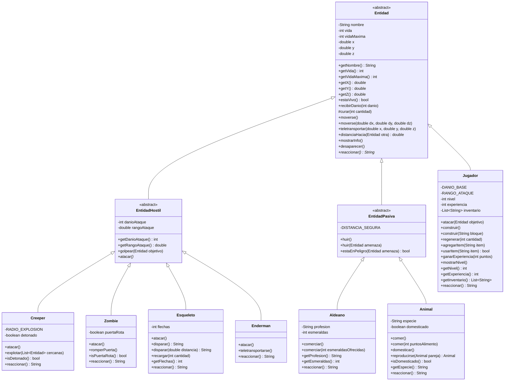
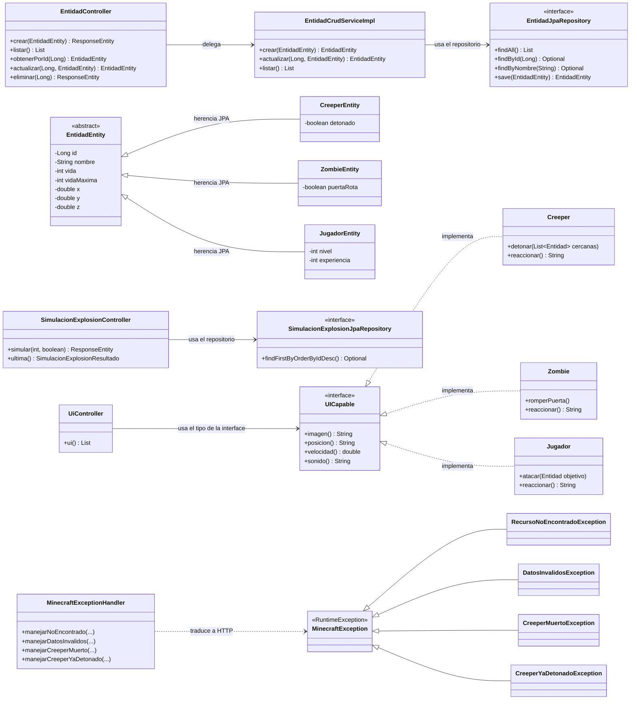

# Minecraft API — Taller de Git 2026

API REST hecha con Spring Boot que expone el modelado de clases de Minecraft
visto en las clases (herencia, sobreescritura y ocultamiento de la
información), como parte del Taller de Git.

**Commit de la solución (POO-08):**
<https://github.com/CeciBasu/clbasualdo-taller-git-2026/commit/fbf5f524d4dad41f39d51d212347165dc89b0f8d>

La entrega anterior (POO-06) quedó documentada en
[`docs/ESPECIFICACIONES-poo-06.md`](docs/ESPECIFICACIONES-poo-06.md).

## Tecnologías

- Java 21
- Spring Boot 4 (Spring Web MVC)
- Spring Data JPA
- H2 (archivo local y consola web)
- Maven

## Cómo correr el proyecto

```bash
git clone https://github.com/CeciBasu/clbasualdo-taller-git-2026.git
cd clbasualdo-taller-git-2026/minecraft
./mvnw spring-boot:run
```

La aplicación queda disponible en `http://localhost:8080`.

Para ver la demostración por consola, sin levantar la API:

```bash
./mvnw -q compile
java -cp target/classes py.edu.uc.lp3.clbasualdo.minecraft.demo.Main
```

## Estructura

| Paquete | Qué contiene |
|---|---|
| `py.edu.uc.lp3.clbasualdo.minecraft.domain` | El modelo: `Entidad`, sus hijas y la interface `UICapable`. No depende de nada externo. |
| `py.edu.uc.lp3.clbasualdo.minecraft.entity` | La familia JPA que mapea la tabla `entidades`: `EntidadEntity` (padre) y `CreeperEntity`, `ZombieEntity`, `JugadorEntity` (hijas). `SimulacionExplosionEntity` guarda el resultado de cada explosión. |
| `py.edu.uc.lp3.clbasualdo.minecraft.repository` | El contrato para guardar y recuperar entidades. `.impl` es la versión en memoria y `.jpa` es Spring Data JPA. |
| `py.edu.uc.lp3.clbasualdo.minecraft.service` | Las reglas de negocio (crear un esqueleto, armar la lista de comportamientos, ejecutar las dos versiones de `disparar()` y simular explosiones persistidas). `.impl` tiene las implementaciones y `.entidad` el servicio del CRUD. |
| `py.edu.uc.lp3.clbasualdo.minecraft.rest.controller` | La entrada HTTP: recibe los datos, delega en los servicios y arma la respuesta. `.handler` tiene el `@RestControllerAdvice` que traduce cada excepción de dominio a su código HTTP. |
| `py.edu.uc.lp3.clbasualdo.minecraft.constants` | `ApiPaths`, con las rutas de la API en un solo lugar. |
| `py.edu.uc.lp3.clbasualdo.minecraft.exceptions` | Excepciones propias del juego: `MinecraftException` como base, `RecursoNoEncontradoException`, `DatosInvalidosException`, `CreeperMuertoException` y `CreeperYaDetonadoException`. |
| `py.edu.uc.lp3.clbasualdo.minecraft.demo` | `Main`, la demostración en consola. Vive aparte del dominio. |
| `MinecraftApplication` | Arranque de Spring Boot. Se queda en la raíz porque desde ahí sale el barrido de componentes. |

## Modelo de dominio

El modelo trata cualquier entidad de forma uniforme (moverse, recibir daño,
desaparecer, reaccionar ante el jugador) sin preguntar de qué tipo concreto
se trata. Las reglas de vida, movimiento y muerte viven en `Entidad`, la
clase base: cada subclase solo redefine lo que realmente cambia.

`nombre` y `vida` son `private`: nadie fuera de la jerarquía puede dejar una
entidad en un estado inválido, ni siquiera las propias hijas. El estado
cambia únicamente a través de mensajes (`recibirDanio`, `curar`) que
validan lo que reciben. `curar()` es `protected` porque no es una operación
que cualquier entidad deba poder recibir desde afuera (un `Creeper` no se
regenera): es una herramienta interna de la jerarquía que usa `Jugador`.

`reaccionar()` es un método abstracto declarado en `Entidad`: expresa un
comportamiento que todas las hijas deben saber responder, pero cuya forma
concreta no puede escribir el padre porque cada tipo se comporta distinto
(un `Creeper` explota, un `Esqueleto` dispara, un `Enderman` se teletransporta,
un `Aldeano` huye).



## Sobrecarga y sobreescritura

Las dos están en el modelo, y conviene no confundirlas: son mecanismos distintos que se
resuelven en momentos distintos de la ejecución.

### Qué se agregó

**Sobreescritura.** `Entidad` declara el método abstracto

```java
public abstract String reaccionar();
```

porque sabe que toda entidad tiene que saber responder ante el jugador, pero no sabe *cómo*:
eso solo lo sabe cada tipo. Lo sobreescriben las siete clases concretas con la misma firma
exacta y su propio cuerpo: `Zombie`, `Esqueleto`, `Creeper`, `Enderman`, `Aldeano`, `Animal` y
`Jugador`. Lo mismo pasa con `EntidadHostil.atacar()`, abstracto, que sobreescriben `Creeper`,
`Zombie`, `Esqueleto` y `Enderman`.

```java
// Entidad.java — la base no puede resolverlo
public abstract String reaccionar();

// Creeper.java — misma firma, cuerpo propio
@Override
public String reaccionar() {
    return getNombre() + " se acerca silbando y está a punto de explotar.";
}

// Aldeano.java — misma firma, otro cuerpo
@Override
public String reaccionar() {
    return getNombre() + " se asusta y corre a esconderse.";
}
```

**Sobrecarga.** El mismo nombre, otra lista de argumentos, todo en la misma clase. La más
nueva es `Esqueleto.disparar()`, que es el caso que pide la consigna: la misma acción de
disparar, con y sin distancia.

```java
// Sin datos: no hay nada que revisar, siempre gasta flecha si le queda alguna.
public String disparar() {
    return disparar(0.0);
}

// Con datos: aparece el contexto. Fuera del rango la flecha se pierde y no se gasta,
// y una distancia negativa se rechaza.
public String disparar(double distancia) { /* ... */ }
```

Las demás sobrecargas del modelo, para que se vea que el patrón ya venía usándose:

| Clase | Versión simple | Versión sobrecargada |
|---|---|---|
| `Esqueleto` | `disparar()` | `disparar(double distancia)` |
| `Entidad` | `moverse()` | `moverse(double dx, double dy, double dz)` |
| `EntidadPasiva` | `huir()` | `huir(Entidad amenaza)` |
| `Aldeano` | `comerciar()` | `comerciar(int esmeraldasOfrecidas)` |
| `Animal` | `comer()` | `comer(int puntosAlimento)` |
| `Jugador` | `construir()` | `construir(String bloque)` |

### Cómo se distingue una de la otra

|  | Sobrecarga | Sobreescritura |
|---|---|---|
| **Dónde** | En la misma clase | En clases distintas de la jerarquía |
| **Qué cambia** | La lista de argumentos | El cuerpo, con la misma firma |
| **Cómo se marca** | No lleva nada especial | Con `@Override` |
| **Cuándo se resuelve** | Al compilar, por la firma | Al ejecutar, por el tipo real del objeto |
| **Para qué sirve** | Darle una versión corta a una acción que tiene una versión completa | Cambiar un comportamiento que el padre no puede saber |

La diferencia clave: si `ComportamientoController` recorre una `List<Entidad>` y llama a
`reaccionar()`, Java no sabe de antemano qué clase es cada elemento. Eso es sobreescritura,
y funciona sin un solo `if` por tipo. En cambio, cuando dentro de `Esqueleto` se llama a
`disparar(5.0)`, el compilador ya sabe que es la versión con `double`: eso es sobrecarga, y
no tiene nada que ver con la herencia.

## Endpoints

| Método | Ruta | Descripción |
|---|---|---|
| `GET` | `/` | Confirma que el servicio está vivo. |
| `GET` | `/esqueleto?nombre=...&vida=...` | Construye un `Esqueleto` con los parámetros de la URL y devuelve su estado en JSON. |
| `GET` | `/esqueleto/disparar` | Muestra la **sobrecarga** de `disparar()` en acción: crea un `Esqueleto` desde la URL, ejecuta `disparar()` y `disparar(double distancia)` y devuelve los dos resultados en el mismo JSON. |
| `GET` | `/comportamiento` | Devuelve, en JSON, la reacción de una entidad de cada tipo frente al jugador. Todas se tratan como `Entidad`: no hay ningún `if` por tipo, cada objeto informa lo suyo. |
| `GET` | `/ui` | Devuelve los datos de las entidades que implementan la interface `UICapable`. |
| `GET` | `/entidades` | Lista todas las entidades persistidas en H2. |
| `POST` | `/entidades` | Crea una entidad y la guarda en H2. El JSON lleva `"tipo"` (`Creeper`, `Zombie` o `Jugador`). |
| `GET` | `/entidades/{id}` | Busca una entidad por id; si no existe responde `404`. |
| `GET` | `/entidades/nombre/{nombre}` | Busca una entidad por nombre; si no existe responde `404`. |
| `PUT` | `/entidades/{id}` | Actualiza una entidad por id; no permite cambiar su subtipo. |
| `PUT` | `/entidades/nombre/{nombre}` | Actualiza una entidad por nombre. |
| `DELETE` | `/entidades/{id}` | Elimina una entidad por id; responde `204`. |
| `DELETE` | `/entidades/nombre/{nombre}` | Elimina una entidad por nombre; responde `204`. |
| `POST` | `/simulacion/explosion` | Ejecuta y persiste la simulación de explosión entre un `Creeper`, un `Zombie` y un `Jugador`. Responde `201`. |
| `GET` | `/simulacion/explosion` | Devuelve la última simulación persistida. |
| `GET` | `/simulacion/explosion/{id}` | Devuelve una simulación persistida por id; si no existe responde `404`. |
| `GET` | `/simulacion/explosiones` | Lista todas las simulaciones persistidas. |

### Ejemplo — `GET /esqueleto?nombre=Bony&vida=15`

```json
{
  "nombre": "Bony",
  "vida": 15,
  "vivo": true,
  "flechas": 16,
  "posicion": { "x": 0.0, "y": 64.0, "z": 0.0 }
}
```

Los parámetros `x`, `y` y `z` son opcionales y por defecto `(0, 64, 0)`. Si un dato no
es válido, la API responde `400` con el mensaje del dominio, sin tirar la excepción:

```json
{ "error": "La vida inicial debe ser mayor a 0." }
```

### Ejemplo — `GET /esqueleto/disparar?nombre=Bony&distancia=5`

Acá se ve la sobrecarga: las dos versiones del mismo mensaje, en el mismo JSON.

```json
{
  "nombre": "Bony",
  "flechasIniciales": 16,
  "flechasRestantes": 14,
  "rango": 8.0,
  "distanciaPedida": 5.0,
  "disparoSinDistancia": "Bony dispara una flecha a 0.0. Le quedan 15.",
  "disparoConDistancia": "Bony dispara una flecha a 5.0. Le quedan 14."
}
```

Y con una distancia fuera del rango se ve la diferencia entre las dos versiones: el disparo
sin distancia gasta la flecha igual, el que lleva distancia no, porque la flecha se pierde.

```json
{
  "nombre": "Bony",
  "flechasIniciales": 16,
  "flechasRestantes": 15,
  "rango": 8.0,
  "distanciaPedida": 20.0,
  "disparoSinDistancia": "Bony dispara una flecha a 0.0. Le quedan 15.",
  "disparoConDistancia": "Bony no alcanza a disparar a 20.0 (rango 8.0) y no gasta flecha."
}
```

Una distancia negativa la rechaza el dominio y la API la avisa con `400`:

```json
{ "error": "La distancia no puede ser negativa." }
```

### Ejemplo — `GET /comportamiento`

```json
[
  {
    "tipo": "Zombie",
    "reaccion": "Zombie gruñe y persigue al jugador.",
    "vida": 20,
    "posicion": { "x": 0.0, "y": 0.0, "z": 0.0 }
  },
  {
    "tipo": "Esqueleto",
    "reaccion": "Esqueleto retrocede y dispara una flecha.",
    "vida": 20,
    "posicion": { "x": 0.0, "y": 0.0, "z": 0.0 }
  },
  {
    "tipo": "Creeper",
    "reaccion": "Creeper se acerca silbando y está a punto de explotar.",
    "vida": 20,
    "posicion": { "x": 0.0, "y": 0.0, "z": 0.0 }
  },
  {
    "tipo": "Enderman",
    "reaccion": "Enderman se teletransporta al ser observado.",
    "vida": 40,
    "posicion": { "x": 0.0, "y": 0.0, "z": 0.0 }
  },
  {
    "tipo": "Aldeano",
    "reaccion": "Aldeano se asusta y corre a esconderse.",
    "vida": 20,
    "posicion": { "x": 0.0, "y": 0.0, "z": 0.0 }
  },
  {
    "tipo": "Animal",
    "reaccion": "Vaca sigue comiendo, no le presta atencion al jugador.",
    "vida": 10,
    "posicion": { "x": 0.0, "y": 0.0, "z": 0.0 }
  }
]
```

## Persistencia H2 y CRUD

La familia persistida tiene un padre y tres hijas. El mapeo usa una sola tabla con un
discriminador, así que las filas de distinto subtipo comparten los datos comunes y cada una
aporta sus columnas propias:

```text
EntidadEntity (abstracta, tabla ENTIDADES, columna TIPO)
├── CreeperEntity   -> TIPO = "Creeper"  (detonado)
├── ZombieEntity    -> TIPO = "Zombie"   (puertaRota)
└── JugadorEntity   -> TIPO = "Jugador"  (nivel, experiencia)
```

### Diagrama de la entrega

El diagrama muestra la familia persistida (`EntidadEntity` y sus hijas), la interface de dominio
`UICapable`, el repositorio Spring Data, los controllers y la jerarquía de excepciones con su
handler:



Cómo se lee el diagrama:

- **Herencia JPA:** `EntidadEntity <|-- CreeperEntity`, `ZombieEntity` y `JugadorEntity` comparten
  la tabla `ENTIDADES` y se distinguen por la columna `tipo`.
- **Implementación de interface:** `UICapable <|.. Creeper`, `Zombie` y `Jugador` (y también
  `Esqueleto`, `Enderman`, `Aldeano` y `Animal`) cumplen el protocolo del dominio.
- **Uso del repositorio:** el controller delega en el servicio y el servicio usa
  `EntidadJpaRepository`; el controller de la simulación usa `SimulacionExplosionJpaRepository`.
- **Jerarquía de excepciones:** `MinecraftException` es la base y `MinecraftExceptionHandler`
  traduce cada hija a un código HTTP distinto.

En el JSON, `@JsonTypeInfo` y `@JsonSubTypes` usan la propiedad `"tipo"` para elegir la clase
concreta. Por eso un mismo `POST /entidades` puede crear cualquiera de los tres subtipos, y un
`GET` devuelve el objeto con su tipo y sus datos propios. El CRUD completo es:

- `POST /entidades`: crea y persiste una entidad; responde `201`.
- `GET /entidades`, `GET /entidades/{id}` y `GET /entidades/nombre/{nombre}`: consultan.
- `PUT /entidades/{id}` y `PUT /entidades/nombre/{nombre}`: actualizan sin permitir cambiar el subtipo.
- `DELETE /entidades/{id}` y `DELETE /entidades/nombre/{nombre}`: eliminan; responden `204`.

Invariantes que aplica el servicio antes de guardar:

- nombre obligatorio y único;
- `vidaMaxima > 0` (si no viene, se toma igual a `vida`);
- `vida >= 0` y `vida <= vidaMaxima`;
- al crear, `vida > 0`;
- el subtipo de una fila existente no cambia en un `PUT`;
- en un `Jugador`, `nivel` y `experiencia` no pueden ser negativos.

La configuración está en `minecraft/src/main/resources/application.properties`. Cada propiedad
y lo que hace:

| Propiedad | Qué significa |
|---|---|
| `spring.application.name=minecraft` | Le da un nombre a la aplicación para los logs y la consola de Spring. |
| `spring.datasource.url=jdbc:h2:file:./data/entidades` | Indica que H2 guarda la base en el archivo `data/entidades.mv.db`, dentro de la carpeta `minecraft`. |
| `spring.datasource.driverClassName=org.h2.Driver` | Elige el driver JDBC de H2 como puente entre Java y la base. |
| `spring.datasource.username=sa` | Usa el usuario administrador por defecto de H2; en este taller no se configura seguridad real. |
| `spring.datasource.password=` | Deja la contraseña vacía, como corresponde al perfil de desarrollo de H2. |
| `spring.jpa.database-platform=org.hibernate.dialect.H2Dialect` | Le dice a Hibernate que genere el SQL con el dialecto de H2. |
| `spring.jpa.hibernate.ddl-auto=update` | Hace que Hibernate cree las tablas si no existen y agregue columnas nuevas sin borrar los datos guardados. |
| `spring.jpa.show-sql=true` | Muestra en la consola el SQL que Hibernate ejecuta, útil para ver la persistencia durante la clase. |
| `spring.jpa.open-in-view=false` | Cierra la sesión JPA al terminar el controller, para que ninguna vista o respuesta dependa de una sesión abierta. |
| `spring.h2.console.enabled=true` | Habilita la consola web de H2 para mirar las tablas desde el navegador. |
| `spring.h2.console.path=/h2-console` | Publica la consola H2 en la ruta `http://localhost:8080/h2-console`. |

La consola H2 queda disponible en:

- URL: `http://localhost:8080/h2-console`
- JDBC URL: `jdbc:h2:file:./data/entidades`
- Usuario: `sa`
- Contraseña: vacía
- Tablas: `ENTIDADES` y `SIMULACIONES_EXPLOSION`

La ruta relativa `./data/entidades` se resuelve desde la carpeta `minecraft`, que es donde se
ejecuta Maven. Esa carpeta está ignorada en `.gitignore` porque es un archivo local generado.
Las pruebas usan una base H2 en memoria (`src/test/resources/application.properties`) para no
bloquear ni modificar la base real del proyecto.

## Simulación de explosiones

La simulación usa tres clases del modelo y después guarda el estado final de las tres:

| Clase | Rol en la simulación |
|---|---|
| `Creeper` | Es la fuente de la explosión. Se autodestruye y daña a las entidades dentro de su radio de 3 bloques. |
| `Zombie` | Entidad hostil ubicada a 2 bloques del Creeper: queda dentro del radio y recibe 25 de daño. |
| `Jugador` | Entidad ubicada a 5 bloques del Creeper: queda fuera del radio y no recibe daño. |

La lista de alcanzables se maneja como `List<Entidad>`, así que la explosión no pregunta por el
tipo concreto de cada víctima: recorre la lista y cada objeto responde con su propia vida y
posición. La lógica de la detonación está en `Creeper.detonar(...)`. El servicio
`SimulacionExplosionServiceImpl` arma el escenario, ejecuta la regla, persiste el estado final
de las tres entidades (`Creeper Simulado`, `Zombie Simulado` y `Steve Simulado`) y guarda una
fila en `SIMULACIONES_EXPLOSION` con la foto completa del resultado.

### Las dos reglas del dominio

1. **Un Creeper solo puede detonar si está vivo:** si recibe daño letal antes de la explosión, el dominio rechaza la detonación con `CreeperMuertoException`.
2. **Un Creeper solo puede detonar una vez:** un segundo intento sobre el mismo Creeper se rechaza con `CreeperYaDetonadoException`.

Las dos reglas ya existían en el comportamiento de `Creeper.explotar(...)`; la nueva
`Creeper.detonar(...)` las hace explícitas con excepciones de dominio propias sin cambiar el
comportamiento anterior de `explotar(...)`.

### Endpoints

| Método | Ruta | Uso |
|---|---|---|
| `POST` | `/simulacion/explosion` | Ejecuta y persiste la simulación; responde `201`. |
| `GET` | `/simulacion/explosion` | Devuelve la última simulación guardada. |
| `GET` | `/simulacion/explosion/{id}` | Devuelve una simulación por id; si no existe responde `404`. |
| `GET` | `/simulacion/explosiones` | Lista todas las simulaciones guardadas. |

Parámetros del `POST`:

| Parámetro | Por defecto | Uso |
|---|---|---|
| `vidaCreeper` | `20` | Vida inicial del Creeper. Con `0` o menos se prueba la regla del Creeper muerto. |
| `repetirDetonacion` | `false` | Con `true` se simula un segundo intento sobre el mismo Creeper para probar la regla de una sola detonación. |

Ejemplo exitoso:

```bash
curl -X POST http://localhost:8080/simulacion/explosion
```

```json
{
  "simulacionId": 1,
  "fecha": "2026-11-09T20:24:26.123",
  "radioExplosion": 3.0,
  "creeper": {
    "nombre": "Creeper Simulado",
    "vidaInicial": 20,
    "vidaFinal": 0,
    "detonado": true,
    "vivo": false,
    "x": 0.0,
    "y": 64.0,
    "z": 0.0
  },
  "afectados": [
    {
      "tipo": "Zombie",
      "nombre": "Zombie Simulado",
      "vidaInicial": 20,
      "vidaFinal": 0,
      "distanciaAlCreeper": 2.0,
      "alcanzada": true
    }
  ],
  "noAfectados": [
    {
      "tipo": "Jugador",
      "nombre": "Steve Simulado",
      "vidaInicial": 20,
      "vidaFinal": 20,
      "distanciaAlCreeper": 5.0,
      "alcanzada": false
    }
  ]
}
```

Después del `POST`, un `GET /simulacion/explosion/{simulacionId}` devuelve el mismo resultado
leído de H2, y `GET /entidades/nombre/Creeper Simulado` muestra que la entidad persistida quedó
con vida `0` y `detonado: true`.

### Jerarquía de excepciones y handlers

```text
MinecraftException
├── RecursoNoEncontradoException     -> HTTP 404
├── DatosInvalidosException          -> HTTP 400
├── CreeperMuertoException           -> HTTP 422
└── CreeperYaDetonadoException       -> HTTP 409
```

`MinecraftExceptionHandler` usa `@RestControllerAdvice` y tiene un `@ExceptionHandler` por cada
excepción concreta. No hay un handler genérico de `Exception`, para que un error de programación
no se convierta en un `400` y siga viéndose como un `500`. Todas las respuestas de error tienen
la misma forma (`timestamp`, `status`, `error`, `tipo`, `mensaje`).

Creeper muerto (`POST /simulacion/explosion?vidaCreeper=0`):

```json
{
  "status": 422,
  "error": "Unprocessable Entity",
  "tipo": "CreeperMuertoException",
  "mensaje": "Creeper no puede detonar: está muerto."
}
```

Creeper ya detonado (`POST /simulacion/explosion?repetirDetonacion=true`):

```json
{
  "status": 409,
  "error": "Conflict",
  "tipo": "CreeperYaDetonadoException",
  "mensaje": "Creeper ya detonó y no puede volver a explotar."
}
```

Datos inválidos (`POST /entidades` con `vida` negativa) responde `400` con
`"tipo": "DatosInvalidosException"`, y un id inexistente responde `404` con
`"tipo": "RecursoNoEncontradoException"`. La colección de Insomnia tiene un pedido para cada
uno de esos casos.

### Interface `UICapable`

`UICapable` es una interface del dominio que declara los datos que una entidad puede mostrar en
una interfaz gráfica. La implementan `Creeper`, `Zombie`, `Esqueleto`, `Enderman`, `Aldeano`,
`Animal` y `Jugador`. `GET /ui` arma una `List<UICapable>` y le pide los datos a cada elemento:
el controller no pregunta por el tipo concreto y cada clase responde lo suyo.

## Preguntas para pensar

**¿Cuál es el sustantivo de la API? ¿La URL nombra al recurso y el verbo HTTP dice la operación?**

El sustantivo es `entidades` (y `simulacion` para el resultado de la explosión). Las URLs
nombran el recurso —`/entidades`, `/entidades/{id}`, `/simulacion/explosion`— y el verbo HTTP
dice qué se hace con él: `POST` crea, `GET` lee, `PUT` actualiza y `DELETE` borra. No hay rutas
como `/crearEntidad` o `/borrarEntidad`.

**¿Qué campo es la clave? ¿Quién la asigna? ¿El JSON de creación la lleva o la omite?**

La clave es `id`, un `Long` autogenerado con `@GeneratedValue(strategy = GenerationType.IDENTITY)`.
La asigna H2 al insertar la fila, no el cliente. El JSON de creación la omite: si llegara un
`id`, la persistencia lo ignora para el alta y el recurso nuevo recibe el número que devuelve
la base.

**¿Cómo guardaron la herencia? ¿Cómo se distingue el subtipo en el JSON?**

Con `InheritanceType.SINGLE_TABLE`: una sola tabla `ENTIDADES` con la columna discriminadora
`tipo` y una fila por entidad. En el JSON se distingue con `@JsonTypeInfo(property = "tipo")` y
`@JsonSubTypes`, así el `POST` y el `GET` hablan de `Creeper`, `Zombie` o `Jugador` sin que el
controller pregunte por la clase. Se eligió `SINGLE_TABLE` porque las tres clases comparten casi
todos los datos y la API las lista juntas; el costo es que las columnas propias de un subtipo
quedan nulas en las filas de los otros.

**¿Qué gana el controller al depender de la interface del repositorio?**

Gana lo mismo que en POO-07: el controller y el servicio hablan con un contrato
(`EntidadJpaRepository`) y no con una implementación concreta. Spring Data genera la
implementación en tiempo de arranque, y si mañana cambia el motor de base solo se toca la
configuración, no el controller.

**¿Qué interface de dominio existe? ¿Qué endpoint la usa? ¿Puede hablar con familias distintas?**

`UICapable` declara `imagen()`, `posicion()`, `velocidad()` y `sonido()`. La usa
`GET /ui` a través de `UiController` y `UiService`, que trabajan con `List<UICapable>`. Sí habla
con familias distintas: la implementan los hostiles (`Creeper`, `Zombie`, `Esqueleto`,
`Enderman`), los pasivos (`Aldeano`, `Animal`) y `Jugador`, que hereda directo de `Entidad`.

**¿Quién sostiene las reglas numéricas del juego? ¿Qué prueba de Insomnia muestra que un `POST` ilegal deja la base igual que antes?**

El dominio sostiene las reglas de vida (`Entidad.recibirDanio`, `curar`, `vidaMaxima`) y el
servicio de CRUD valida los invariantes antes de llamar a `save(...)`: nombre obligatorio y
único, `vidaMaxima > 0`, `0 <= vida <= vidaMaxima`, `vida > 0` al crear y valores no negativos
en `nivel` y `experiencia`. El pedido **12 - Error: POST ilegal (400)** manda `vida: -5`; el
handler responde `400` con `DatosInvalidosException` y la prueba automatizada comprueba que el
contador de filas no cambió.

**`PUT` y `PATCH`: ¿reemplazan el recurso entero o un subconjunto? ¿Qué pasa con un campo omitido?**

Se implementó `PUT`, que reemplaza el recurso completo: el cuerpo trae todos los datos de la
entidad y `copiarDatosDesde(...)` pisa los campos comunes y los propios del subtipo. Un campo
omitido queda con el valor por defecto del tipo (`0`, `false` o `null`), no conserva el valor
anterior; por eso la colección de Insomnia manda el objeto completo también en la actualización.
No se agregó `PATCH` porque el enunciado permite uno de los dos y `PUT` deja la operación clara.

**`DELETE`: ¿qué significa borrar en el modelo? ¿Ese verbo HTTP habla con un mensaje del dominio?**

Borrar significa quitar la fila de `ENTIDADES`; no se marca como eliminada. `DELETE` no es un
mensaje del dominio del juego: es una operación de persistencia. El controller la traduce a
`EntidadCrudService.eliminar(...)`, que primero busca la entidad —si no existe lanza
`RecursoNoEncontradoException` y el handler responde `404`— y después llama a `delete(...)`.
Cuando borra bien responde `204`, y un `GET` posterior devuelve `404`.

**¿Qué dos hechos del juego cambian el estado de más de un objeto a la vez? ¿Cómo se llama el recurso HTTP de la simulación? ¿Un `GET` posterior muestra el resultado ya persistido?**

La explosión de un Creeper vivo cambia el estado de tres objetos: el Creeper muere y se marca
como detonado, el Zombie dentro del radio de 3 bloques recibe 25 de daño y muere, y el Jugador
fuera del radio conserva su vida. El recurso HTTP es `POST /simulacion/explosion`; después,
`GET /simulacion/explosion/{id}`, `GET /simulacion/explosion` y `GET /simulacion/explosiones`
leen el resultado desde H2, y `GET /entidades/nombre/Creeper Simulado` muestra el estado final
de la entidad persistida.

**¿Cómo se llama cada clase de la jerarquía y por qué? ¿Un recurso inexistente y una regla de juego incumplida son tipos distintos? ¿Qué lleva el JSON de error?**

La base es `MinecraftException` y las hijas son `RecursoNoEncontradoException` (el id no
existe), `DatosInvalidosException` (el cuerpo rompe un invariante), `CreeperMuertoException`
(se intenta detonar un Creeper sin vida) y `CreeperYaDetonadoException` (segunda detonación).
Sí, son tipos distintos: recurso inexistente es `404`, dato inválido es `400`, Creeper muerto
es `422` y segunda detonación es `409`. El JSON de error siempre lleva `timestamp`, `status`,
`error`, `tipo` y `mensaje`, y `MinecraftExceptionHandler` tiene un `@ExceptionHandler` por
cada hija.

**¿Por qué separar `domain` de `entity`?**

Porque el dominio modela el juego y no debe depender de JPA ni de Jackson. `Entidad` y sus
hijas sirven para el demo de consola y para la simulación, mientras que `EntidadEntity` y sus
hijas son el mapeo de la tabla. Así las reglas del juego no se mezclan con detalles de
persistencia.

**¿Por qué la simulación guarda también las entidades y no solo el resultado?**

Porque el pedido es que la simulación se pueda consultar después y que el estado final de las
entidades quede persistido. Guardar la foto en `SIMULACIONES_EXPLOSION` permite responder un
`GET` sin volver a ejecutar la explosión, y guardar las entidades permite ver el efecto en el
CRUD.

**¿Qué pasa si el controller arma el JSON a mano?**

Se pierde el polimorfismo: habría que preguntar por el tipo con `if` o `instanceof`. Con
`@JsonTypeInfo` y `@JsonSubTypes`, Jackson elige la clase concreta a partir de `"tipo"` y el
controller solo devuelve `EntidadEntity`.

## Colección Insomnia

La colección exportable está en
[`docs/insomnia/minecraft-explosiones.json`](docs/insomnia/minecraft-explosiones.json).

Para importarla:

1. Abrir Insomnia.
2. Ir a `Application` → `Import` → `From File`.
3. Elegir `docs/insomnia/minecraft-explosiones.json`.
4. Seleccionar el environment `Base local` y verificar que `base_url` sea
   `http://localhost:8080`.
5. Arrancar la aplicación con `./mvnw spring-boot:run` y ejecutar las solicitudes en orden.

La colección incluye:

- simulación exitosa y sus tres consultas posteriores (`GET` por id, última y lista);
- error de Creeper muerto (`422`);
- error de Creeper ya detonado (`409`);
- CRUD: listar, crear, obtener por nombre, actualizar por nombre y eliminar por nombre;
- POST ilegal (`400`, `DatosInvalidosException`);
- id inexistente (`404`, `RecursoNoEncontradoException`);
- `GET /ui` para ver la interface `UICapable` en acción.

Para el CRUD, si se ejecuta `Crear entidad` más de una vez, el nombre duplicado responde `400`.
Eliminar la entidad antes de volver a crearla, o cambiar `entidad_nombre` en el environment.
Para `Consultar simulación por id`, copiar el `simulacionId` que devuelve la simulación exitosa
en la variable `simulacion_id` del environment.

**Aclaración de verificación:** la colección se entrega lista para importar, pero en esta
entrega las pruebas automatizadas se ejecutaron con Maven y MockMvc, y la aplicación se verificó
con `curl` y una consulta directa a H2. No se afirma que las solicitudes se hayan ejecutado desde
la interfaz de Insomnia.

## Pruebas

```bash
./mvnw test
```

67 pruebas. Sobre el dominio: los límites de vida y el ocultamiento de estado
(`EntidadTest`), el radio y la unicidad de la explosión (`CreeperTest`), la huida y
el borde exacto de peligro (`EntidadPasivaTest`), la munición, el alcance del
esqueleto y las dos versiones de `disparar()` (`EsqueletoTest`), el ataque y la reacción
del Enderman (`EndermanTest`), el inventario y la experiencia (`JugadorTest`), y que la
jerarquía se use sin preguntar por el tipo (`PolimorfismoTest`). Sobre la entrada HTTP,
`ApiControllerTest` levanta el contexto con MockMvc y prueba las rutas anteriores, incluido
que un dato inválido termine en `400` y no en un `500`.

Las pruebas de esta entrega son:

- `SimulacionExplosionServiceImplTest`: caso exitoso persistido y las dos excepciones de dominio.
- `SimulacionExplosionControllerTest`: POST exitoso, GET por id, última, lista, `422` y `409` con su JSON.
- `EntidadCrudControllerTest`: CRUD completo, subtipos, POST ilegal, id inexistente y cambio de tipo prohibido.

## Bitácora y documentación

- **[`docs/BITACORA.md`](docs/BITACORA.md)** — bitácora de la entrega: con qué asistentes y
  qué modelos de LLM se trabajó, el resumen de los prompts, y el relato de cómo se fue
  tocando la jerarquía.
- **[`docs/ESPECIFICACIONES-poo-08.md`](docs/ESPECIFICACIONES-poo-08.md)** — consignas de
  POO-08 y dónde se cumple cada una.

## Resumen de la evolución del proyecto

1. **Endurecimiento del modelo.** `Entidad` sumó posición (`x, y, z`), `moverse`,
   `teletransportar`, `distanciaHacia`, `vidaMaxima` y `toString`/`equals`/`hashCode`.
   `EntidadHostil` ganó ataque real con daño y rango, `EntidadPasiva` aprendió a huir y las
   subclases concretas recibieron su comportamiento propio.
2. **Primeros controllers.** `GET /` confirmaba que el servicio estaba vivo,
   `GET /esqueleto` construía un esqueleto desde la URL y `GET /comportamiento` mostraba la
   reacción polimórfica de cada tipo.
3. **Git.** Se resolvió un caso real de ramas divergentes con `git pull --rebase origin main`
   y se verificó que el remoto quedara igual al local.
4. **README y diagrama.** Se documentó el código y se agregó el diagrama Mermaid de la
   jerarquía.
5. **Refactor a capas.** El proyecto se ordenó en `domain`, `repository` (+ `impl`),
   `service` (+ `impl`), `rest.controller`, `constants` y `exceptions`, con
   `MinecraftApplication` en la raíz y el dominio sin Spring.
6. **Enderman.** Se corrigió su constructor, se sumó a `/comportamiento` y se agregaron sus
   pruebas.
7. **Sobrecarga y sobreescritura.** Se agregó `Esqueleto.disparar()` /
   `disparar(double distancia)`, su ruta `/esqueleto/disparar` y el apartado del README que
   explica ambos mecanismos.
8. **Explosiones, H2 e Insomnia.** Se agregó la simulación con `Creeper`, `Zombie` y
   `Jugador`, las excepciones `CreeperMuertoException` y `CreeperYaDetonadoException`, el
   handler HTTP y la colección de Insomnia.
9. **POO-08.** La tabla `ENTIDADES` pasó a una familia `SINGLE_TABLE` con `EntidadEntity`
   como padre y `CreeperEntity`, `ZombieEntity` y `JugadorEntity` como hijas. El CRUD valida
   los invariantes y usa `@JsonTypeInfo` / `@JsonSubTypes` para discriminar el `"tipo"`. La
   simulación persiste el estado final de las tres entidades y guarda una foto en
   `SIMULACIONES_EXPLOSION`, con `GET` por id, última y lista. La jerarquía de excepciones
   quedó con `MinecraftException` como base y un handler por tipo: `404`, `400`, `422` y
   `409`.

Estado final verificado: `./mvnw test` → **67 pruebas**, BUILD SUCCESS.

## Licencia

Este proyecto está bajo licencia Apache 2.0. Ver [LICENSE](./LICENSE).
