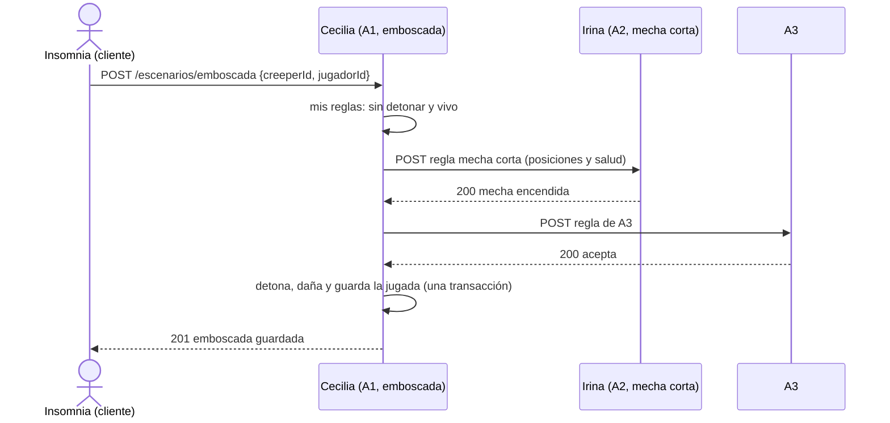
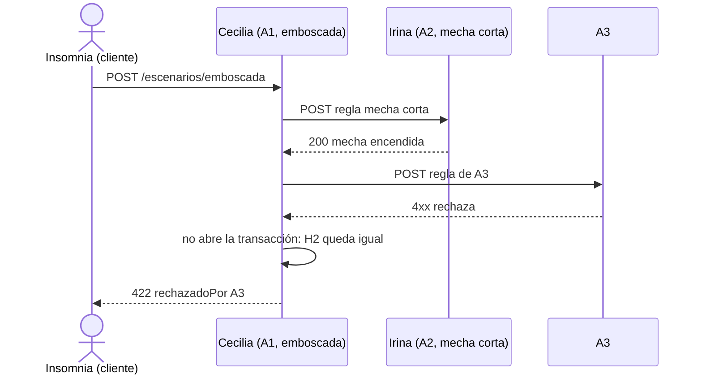
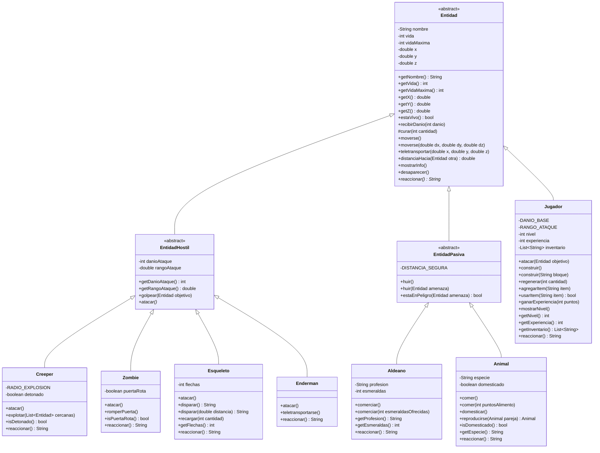
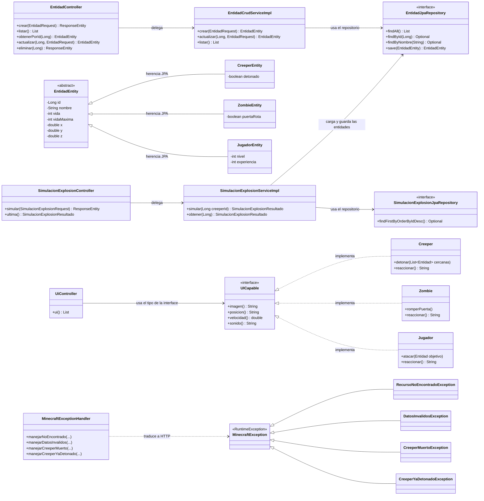

# Minecraft API — Taller de Git 2026

API REST hecha con Spring Boot que expone el modelado de clases de Minecraft
visto en las clases (herencia, sobreescritura y ocultamiento de la
información), como parte del Taller de Git.

**Commit de la solución (POO-09):** el enlace exacto está en el archivo de entrega subido a
Classroom.

- **OpenAPI:** <http://localhost:8083/v3/api-docs> (JSON), <http://localhost:8083/v3/api-docs.yaml>
  (YAML) y <http://localhost:8083/swagger-ui.html> (navegador). Copia exportada en
  [`docs/openapi/`](docs/openapi/).
- **Bitácora de IA:** [`docs/BITACORA.md`](docs/BITACORA.md).
- **Colección de Insomnia:** [`docs/insomnia/minecraft-poo09.json`](docs/insomnia/minecraft-poo09.json),
  con respuestas de ejemplo en [`docs/insomnia/respuestas/`](docs/insomnia/respuestas/).

Las entregas anteriores quedaron documentadas en
[`docs/ESPECIFICACIONES-poo-06.md`](docs/ESPECIFICACIONES-poo-06.md) y
[`docs/ESPECIFICACIONES-poo-08.md`](docs/ESPECIFICACIONES-poo-08.md).

## Situación de POO-08

POO-08 tuvo observaciones y descuentos (16 de 24). Todas quedaron cerradas en esta entrega:

| # | Observación de la corrección | Cómo se cerró |
|---|---|---|
| 2 | **Paquetes.** El dominio lanzaba excepciones y tenía reglas: `Creeper.detonar` lanzaba `CreeperMuertoException` y `CreeperYaDetonadoException`, y `Entidad` y otras clases lanzaban `IllegalArgumentException`. | El paquete `domain` ya no tiene ningún `throw` ni valida datos: guarda el estado encapsulado y lo cambia. `Creeper.detonar` se eliminó; las dos reglas están en `SimulacionExplosionServiceImpl.validarQuePuedeDetonar`. Las validaciones de nombre, vida y distancia del Esqueleto están en `EsqueletoServiceImpl`. Las pruebas de dominio que esperaban excepciones se reemplazaron por pruebas del service y de la API. |
| 3 | **Invariantes.** `EntidadEntity` y sus hijas tenían setters públicos y por HTTP se aceptaba un Creeper con `detonado: true` y `vida: 5`, un estado imposible en Minecraft. | Las Entity no tienen setters públicos: se arman con el constructor y solo cambian con `recibirDanio` (solo quita vida) y `CreeperEntity.registrarDetonacion` (detonado y vida 0 en el mismo paso). El CRUD recibe un DTO (`EntidadRequest`) y `EntidadCrudServiceImpl` valida la combinación al crear y al actualizar: «detonado y con vida» responde `400`, un Creeper no se crea detonado ni se detona con un `PUT`, uno detonado no vuelve atrás y un Creeper o Zombie muerto no revive. Prueba: `EntidadCrudControllerTest.unCreeperDetonadoYConVidaSeRechaza`. |
| 3 (mejora) | Un cuerpo incompleto (sin `x`, `y` o `z`) tenía que responder `DatosInvalidosException` y no el error genérico de JSON. | `x`, `y`, `z`, `tipo`, `nombre` y `vida` son obligatorios en el service, y el handler traduce un JSON ilegible o un parámetro con tipo equivocado a `400` con `DatosInvalidosException`. Prueba: `unCuerpoIncompletoOMalFormadoEsDatoInvalido`. |
| 6 | **Comportamiento observable.** La simulación creaba siempre un Creeper, un Zombie y un Jugador nuevos y los errores salían de parámetros (`vidaCreeper=0`, `repetirDetonacion=true`). Dos simulaciones seguidas respondían `201`. | `POST /simulacion/explosion` recibe `{"creeperId": n}`, carga ese Creeper de H2, daña a las entidades guardadas dentro del radio y guarda el resultado. Un segundo `POST` con el mismo id encuentra el Creeper detonado y responde `409`; un Creeper guardado con vida 0 responde `422`. Los parámetros de prueba se eliminaron. Pruebas: `SimulacionExplosionControllerTest` y `SimulacionExplosionServiceImplTest`. |
| 7 (mejora) | Un commit con `feat:` solo cambiaba el README. | Los commits de esta entrega usan el prefijo del cambio real: `fix:` para las correcciones de código, `docs:` para documentación. |
| 8 | **Documentación.** El diagrama dibujaba `SimulacionExplosionController --> SimulacionExplosionJpaRepository`, pero el controller usa el service. | El diagrama y «Cómo se lee el diagrama» muestran controller → service → repositorios, como en el código. |
| 8 | **Ortografía.** Errores en `MinecraftApplication.java` (líneas 7, 11 y 18: «Descripcion», «aplicacion», «Metodo») y Javadoc casi entero sin tildes. | Se corrigieron esos cuatro y se revisó el Javadoc y los comentarios de todo `src/` (main y test) contra el diccionario de español de hunspell, más una revisión a mano de las palabras ambiguas (*está/esta*, *cómo/como*, *sí/si*, *disparo/disparó*). |
| 8 (mejora) | El ejemplo de la simulación mostraba «Creeper Simulado» y la respuesta real traía «Creeper». | El ejemplo del README ahora es una respuesta real de la simulación sobre entidades creadas con el CRUD. |

## POO-09 — APIs cruzadas

### Grupo y round robin

Grupo de Minecraft. Cada una es A1 de su propia entrega y consulta a las otras dos.

| Nombre | Rol en esta entrega | URL base | OpenAPI | Sus dos reglas, en una frase cada una |
|---|---|---|---|---|
| Cecilia Basualdo ([CeciBasu/clbasualdo-taller-git-2026](https://github.com/CeciBasu/clbasualdo-taller-git-2026)) | **A1** | `http://100.122.114.103:8083` (local `http://localhost:8083`) | `http://100.122.114.103:8083/v3/api-docs` | 1) Un Creeper solo detona si está vivo (si no, `422`). 2) Un Creeper solo detona una vez (si no, `409`). |
| Irina Insfrán ([IrinaInsfran/ii-taller-git-2026](https://github.com/IrinaInsfran/ii-taller-git-2026)) | **A2** | `http://100.87.95.24:8082` (local `http://localhost:8082`) | `http://100.87.95.24:8082/v3/api-docs` | 1) **Mecha corta:** un Creeper vivo solo enciende la mecha si hay un Jugador vivo a 3 bloques o menos (si no, `422 fuera_de_alcance`). 2) **Onda expansiva:** la explosión le resta a cada entidad del radio más vida cuanto más cerca esté. Fuente: [su README](https://github.com/IrinaInsfran/ii-taller-git-2026#las-dos-reglas-de-la-simulación). |
| Sol | **A3** | `http://100.87.131.50:8080` (local `http://localhost:8080`) | `http://100.87.131.50:8080/v3/api-docs` | 1) El Creeper no detona antes de `tiempoExplosion`: con `tiempoTranscurrido` menor responde `409`. 2) Solo daña objetivos dentro del radio: si uno está más lejos de `radioExplosion` responde `422`. Fuente: su OpenAPI en `POST /explosiones/validar`. |

Las respuestas de `docs/insomnia/respuestas/` se grabaron contra los servicios reales de Irina y
Sol por Tailscale, con el entorno «Grupo por Tailscale (servicios reales)» de la colección: ya no
hay respuestas `A3-stub`. Los rechazos de cada una llegan dentro de `respuestaCompanero`, con su
código original (`422` de A2, `409` o `422` de Sol) y `estadoCompanero`.

En el trío, las tres anotamos las mismas tres URLs. Mi OpenAPI publica mis dos reglas en rutas
que no modifican la base, para que A2 y A3 las consulten desde su escenario:
`POST /reglas/creeper-vivo` y `POST /reglas/detonacion-unica`, o las dos juntas en
`POST /explosiones/validar`.

### El escenario: emboscada del Creeper

**En una frase:** un Creeper guardado se acerca a un Jugador guardado y detona; la jugada es
legal solo si A2 confirma que la mecha se enciende (hay un jugador vivo a 3 bloques o menos) y
A3 la acepta con su regla, y recién ahí se ejecuta la explosión y se guarda la jugada en mi H2.

```bash
curl -X POST http://localhost:8083/escenarios/emboscada \
  -H "Content-Type: application/json" \
  -d '{"creeperId": 1, "jugadorId": 2, "tiempoTranscurrido": 3}'
```

| Método | Ruta | Uso |
|---|---|---|
| `POST` | `/escenarios/emboscada` | Cuerpo `{"creeperId": n, "jugadorId": m, "tiempoTranscurrido": 3}`. El tiempo va a Sol; si todo acepta, `201` con la jugada guardada. |
| `GET` | `/escenarios/emboscadas` | Lista las jugadas guardadas. |
| `GET` | `/escenarios/emboscadas/{id}` | Una jugada guardada, con la explosión leída de H2. |

**Orden de consulta y por qué:**

1. **Mis dos reglas** (Creeper sin detonar y vivo). No salen de la máquina: si fallan, no tiene
   sentido molestar a nadie.
2. **A2, mecha corta.** Es lo primero que pasa en el juego: si ningún jugador está cerca, el
   Creeper ni enciende la mecha y no hay nada más que validar.
3. **A3.** Se consulta con la mecha ya encendida.
4. Si las dos aceptan, en **una transacción**: la simulación detona el Creeper (vuelve a aplicar
   mis reglas sobre H2), le quita vida a las entidades del radio y se guarda una fila en
   `EMBOSCADAS` con el id de la explosión y la respuesta de A2 y de A3.

**Qué se ve en mi base después del feliz:** el Creeper con `detonado: true` y vida 0, el Jugador
con 25 de vida menos, una fila nueva en `EXPLOSIONES` y una en `EMBOSCADAS`
(`GET /escenarios/emboscadas/{id}`).

**Qué queda igual si A2 acepta y A3 rechaza:** todo. Las llamadas a A2 y A3 se hacen antes de
abrir la transacción, así que con un rechazo no se detona el Creeper, no cambia ninguna vida y
no se agrega ninguna fila. La respuesta dice de quién fue el rechazo.





### Cliente: cómo se configuran A2 y A3

Los clientes están en el paquete `cliente`: `ClienteReglaCompanero` hace el `POST` y lee la
respuesta, y `ClienteA2MechaCorta` y `ClienteA3` solo arman el cuerpo que pide el OpenAPI de
cada una. Las URLs y las rutas están en `application.properties` y se pueden cambiar con
variables de entorno:

| Propiedad | Variable de entorno | Valor por defecto |
|---|---|---|
| `companeros.a2.base-url` | `A2_BASE_URL` | `http://localhost:8082` |
| `companeros.a2.ruta` | `A2_RUTA` | `/api/minecraft/reglas/mecha-corta` |
| `companeros.a3.base-url` | `A3_BASE_URL` | `http://localhost:8080` |
| `companeros.a3.ruta` | `A3_RUTA` | `/explosiones/validar` |
| `companeros.a3.nombre` | `A3_NOMBRE` | `Sol` |
| `companeros.timeout-ms` | — | `3000` |

Por ejemplo, si A2 está en otra notebook de la sala:

```bash
A2_BASE_URL=http://100.87.95.24:8082 A3_BASE_URL=http://100.87.131.50:8080 ./mvnw spring-boot:run
```

Los dos clientes envían el mismo cuerpo a sus rutas reales: `saludCreeper`, `creeper` con
`x/y/z`, `objetivos` con `tipo/salud/posicion`, y además `tiempoExplosion`,
`tiempoTranscurrido` y `radioExplosion=3.0` que Sol exige e Irina ignora. El cuerpo está en
`cliente/CuerpoReglasCompanero.java`.

### Errores: cómo se atribuyen

Las respuestas de A2 y A3 se **traducen** a mi jerarquía, sin perder la original:

```text
MinecraftException
└── CompaneroException (rol, companero, estadoCompanero, respuestaCompanero)
    ├── RechazoDeCompaneroException     -> HTTP 422  (la regla del compañero respondió 4xx)
    └── CompaneroNoDisponibleException  -> HTTP 503  (5xx, conexión rechazada o tiempo agotado)
```

El handler distingue «la regla de A2 rechazó» de «la API de A3 no responde» y lo dice en el
cuerpo con `rechazadoPor`, `companero`, `estadoCompanero` y `respuestaCompanero` (el cuerpo
que mandó el compañero, tal cual). Ejemplo (respuesta real con un stub en el puerto de A2):

```json
{
  "status": 422,
  "error": "Unprocessable Entity",
  "tipo": "RechazoDeCompaneroException",
  "mensaje": "Rechazo de A2 (Irina Insfrán, regla mecha corta): la jugada no se guardó.",
  "rechazadoPor": "A2",
  "companero": "Irina Insfrán",
  "estadoCompanero": 422,
  "respuestaCompanero": "{\"error\": \"fuera_de_alcance\", ...}"
}
```

### Cómo arrancar los tres servicios

En la misma máquina, cada uno en su terminal y en su puerto. Primero A2 y A3, después A1.

```bash
# A2 — Irina Insfrán
git clone https://github.com/IrinaInsfran/ii-taller-git-2026.git
cd ii-taller-git-2026 && git checkout <commit-de-A2>
./mvnw spring-boot:run -Dspring-boot.run.arguments=--server.port=8082
```

```bash
# A3 — Sol
git clone <repositorio-de-A3> && cd <carpeta-de-A3> && git checkout <commit-de-A3>
./mvnw spring-boot:run -Dspring-boot.run.arguments=--server.port=8080
```

```bash
# A1 — este repositorio (puerto 8083 por defecto)
git clone https://github.com/CeciBasu/clbasualdo-taller-git-2026.git
cd clbasualdo-taller-git-2026/minecraft && git checkout c01d2b5416ef6f90df0d7800239643f98b131a52
./mvnw spring-boot:run
```

**Commit de entrega:** `c01d2b5416ef6f90df0d7800239643f98b131a52` (`c01d2b5`), rama
`poo-09-apis-cruzadas`. No se hizo merge a `main`; el push por HTTPS quedó pendiente de
credenciales de GitHub.

Después, en Insomnia: carpeta 0 (los tres OpenAPI), carpeta 1 (preparar entidades en A1) y
carpeta 2 (escenario feliz, rechazo de A2 y rechazo de A3).

### Si A2 o A3 no responden

- Mi servicio no se cae: responde `503 CompaneroNoDisponibleException` con el rol del que
  falló y no guarda nada. Cada llamada tiene un tiempo máximo de 3 segundos.
- Los clientes están en el código, las URLs en este README y en `application.properties`, y la
  colección trae **respuestas de ejemplo** del feliz y de cada rechazo en
  [`docs/insomnia/respuestas/`](docs/insomnia/respuestas/). Esas respuestas se obtuvieron con el
  servicio real y dos servidores de prueba en los puertos 8082 y 8080 que respondían como A2 y A3,
  y así está indicado en cada una.
- Las pruebas automáticas (`EmboscadaControllerTest`) levantan dos servidores HTTP de prueba y
  cubren el feliz, el rechazo de A2, el de A3, A2 caído y mis reglas cortando antes de llamar.

### Pregunta de anclaje

*Si el compañero cambia el nombre de una ruta, ¿alcanza con actualizar lo que dice el OpenAPI,
o había código copiado de su dominio?* Alcanza con actualizar la propiedad
(`companeros.a2.ruta` o `A2_RUTA`). No hay ninguna clase de A2 ni de A3 en este proyecto: el
cliente solo arma un JSON con los nombres de campos de su OpenAPI y lee el código HTTP. Si
cambiara la forma del cuerpo, se cambia el método `validar(...)` de su cliente, nada más.

### Límite

No se clonó el código de las compañeras para copiar reglas. La regla de A2 se tomó de su README
y la ruta de su OpenAPI. Como su API de POO-08 aplica la regla solo dentro de
`POST /api/minecraft/explosiones` (que crea una explosión en su base), se le pidió publicar la
regla en una ruta que no guarde nada, igual que hice con las mías.

## Tecnologías

- Java 21
- Spring Boot 4 (Spring Web MVC)
- Spring Data JPA
- H2 (archivo local y consola web)
- Maven

## Cómo correr el proyecto

```bash
git clone https://github.com/CeciBasu/clbasualdo-taller-git-2026.git
cd clbasualdo-taller-git-2026/minecraft
./mvnw spring-boot:run
```

La aplicación queda disponible en `http://localhost:8083` (el puerto 8083 es el de A1 dentro
del grupo; se puede cambiar con la variable `PORT`).

Para ver la demostración por consola, sin levantar la API:

```bash
./mvnw -q compile
java -cp target/classes py.edu.uc.lp3.clbasualdo.minecraft.demo.Main
```

## Estructura

| Paquete | Qué contiene |
|---|---|
| `py.edu.uc.lp3.clbasualdo.minecraft.domain` | El modelo: `Entidad`, sus hijas y la interface `UICapable`. Guarda el estado encapsulado y lo cambia con mensajes; no valida datos ni lanza excepciones. No depende de nada externo. |
| `py.edu.uc.lp3.clbasualdo.minecraft.dto` | Los cuerpos JSON que entran: `EntidadRequest` (CRUD) y `SimulacionExplosionRequest`. Admiten `null` para que el service distinga «no vino» de «vino 0». |
| `py.edu.uc.lp3.clbasualdo.minecraft.entity` | La familia JPA que mapea la tabla `entidades`: `EntidadEntity` (padre) y `CreeperEntity`, `ZombieEntity`, `JugadorEntity` (hijas). No tienen setters públicos. `SimulacionExplosionEntity` y `ImpactoExplosion` guardan la foto de cada explosión. |
| `py.edu.uc.lp3.clbasualdo.minecraft.repository` | El contrato para guardar y recuperar entidades. `.impl` es la versión en memoria y `.jpa` es Spring Data JPA. |
| `py.edu.uc.lp3.clbasualdo.minecraft.service` | Las validaciones, las reglas del juego y las excepciones: crear un esqueleto, ejecutar las dos versiones de `disparar()`, los invariantes del CRUD y las dos reglas de la explosión. `.impl` tiene las implementaciones y `.entidad` el servicio del CRUD. |
| `py.edu.uc.lp3.clbasualdo.minecraft.rest.controller` | La entrada HTTP: recibe los datos, delega en los servicios y arma la respuesta. `.handler` tiene el `@RestControllerAdvice` que traduce cada excepción de dominio a su código HTTP. |
| `py.edu.uc.lp3.clbasualdo.minecraft.constants` | `ApiPaths`, con las rutas de la API en un solo lugar. |
| `py.edu.uc.lp3.clbasualdo.minecraft.exceptions` | Excepciones propias del juego: `MinecraftException` como base, `RecursoNoEncontradoException`, `DatosInvalidosException`, `CreeperMuertoException` y `CreeperYaDetonadoException`. |
| `py.edu.uc.lp3.clbasualdo.minecraft.demo` | `Main`, la demostración en consola. Vive aparte del dominio. |
| `MinecraftApplication` | Arranque de Spring Boot. Se queda en la raíz porque desde ahí sale el barrido de componentes. |

## Modelo de dominio

El modelo trata cualquier entidad de forma uniforme (moverse, recibir daño,
desaparecer, reaccionar ante el jugador) sin preguntar de qué tipo concreto
se trata. El estado común (vida, posición) vive en `Entidad`, la clase base:
cada subclase solo redefine lo que realmente cambia.

`nombre` y `vida` son `private`: el estado cambia únicamente a través de
mensajes (`recibirDanio`, `curar`). Desde la corrección de POO-08 el dominio
**no valida ni lanza excepciones**: guarda el estado encapsulado y lo cambia.
Las validaciones (nombre vacío, vida no positiva, distancia negativa) y las
reglas del juego (un Creeper solo detona vivo y una sola vez) las aplica la
capa `service` antes de enviar el mensaje. `curar()` es `protected` porque no es una operación
que cualquier entidad deba poder recibir desde afuera (un `Creeper` no se
regenera): es una herramienta interna de la jerarquía que usa `Jugador`.

`reaccionar()` es un método abstracto declarado en `Entidad`: expresa un
comportamiento que todas las hijas deben saber responder, pero cuya forma
concreta no puede escribir el padre porque cada tipo se comporta distinto
(un `Creeper` explota, un `Esqueleto` dispara, un `Enderman` se teletransporta,
un `Aldeano` huye).



## Sobrecarga y sobreescritura

Las dos están en el modelo, y conviene no confundirlas: son mecanismos distintos que se
resuelven en momentos distintos de la ejecución.

### Qué se agregó

**Sobreescritura.** `Entidad` declara el método abstracto

```java
public abstract String reaccionar();
```

porque sabe que toda entidad tiene que saber responder ante el jugador, pero no sabe *cómo*:
eso solo lo sabe cada tipo. Lo sobreescriben las siete clases concretas con la misma firma
exacta y su propio cuerpo: `Zombie`, `Esqueleto`, `Creeper`, `Enderman`, `Aldeano`, `Animal` y
`Jugador`. Lo mismo pasa con `EntidadHostil.atacar()`, abstracto, que sobreescriben `Creeper`,
`Zombie`, `Esqueleto` y `Enderman`.

```java
// Entidad.java — la base no puede resolverlo
public abstract String reaccionar();

// Creeper.java — misma firma, cuerpo propio
@Override
public String reaccionar() {
    return getNombre() + " se acerca silbando y está a punto de explotar.";
}

// Aldeano.java — misma firma, otro cuerpo
@Override
public String reaccionar() {
    return getNombre() + " se asusta y corre a esconderse.";
}
```

**Sobrecarga.** El mismo nombre, otra lista de argumentos, todo en la misma clase. La más
nueva es `Esqueleto.disparar()`, que es el caso que pide la consigna: la misma acción de
disparar, con y sin distancia.

```java
// Sin datos: no hay nada que revisar, siempre gasta flecha si le queda alguna.
public String disparar() {
    return disparar(0.0);
}

// Con datos: aparece el contexto. Fuera del rango la flecha se pierde y no se gasta,
// y una distancia negativa se rechaza.
public String disparar(double distancia) { /* ... */ }
```

Las demás sobrecargas del modelo, para que se vea que el patrón ya venía usándose:

| Clase | Versión simple | Versión sobrecargada |
|---|---|---|
| `Esqueleto` | `disparar()` | `disparar(double distancia)` |
| `Entidad` | `moverse()` | `moverse(double dx, double dy, double dz)` |
| `EntidadPasiva` | `huir()` | `huir(Entidad amenaza)` |
| `Aldeano` | `comerciar()` | `comerciar(int esmeraldasOfrecidas)` |
| `Animal` | `comer()` | `comer(int puntosAlimento)` |
| `Jugador` | `construir()` | `construir(String bloque)` |

### Cómo se distingue una de la otra

|  | Sobrecarga | Sobreescritura |
|---|---|---|
| **Dónde** | En la misma clase | En clases distintas de la jerarquía |
| **Qué cambia** | La lista de argumentos | El cuerpo, con la misma firma |
| **Cómo se marca** | No lleva nada especial | Con `@Override` |
| **Cuándo se resuelve** | Al compilar, por la firma | Al ejecutar, por el tipo real del objeto |
| **Para qué sirve** | Darle una versión corta a una acción que tiene una versión completa | Cambiar un comportamiento que el padre no puede saber |

La diferencia clave: si `ComportamientoController` recorre una `List<Entidad>` y llama a
`reaccionar()`, Java no sabe de antemano qué clase es cada elemento. Eso es sobreescritura,
y funciona sin un solo `if` por tipo. En cambio, cuando dentro de `Esqueleto` se llama a
`disparar(5.0)`, el compilador ya sabe que es la versión con `double`: eso es sobrecarga, y
no tiene nada que ver con la herencia.

## Endpoints

| Método | Ruta | Descripción |
|---|---|---|
| `GET` | `/` | Confirma que el servicio está vivo. |
| `GET` | `/esqueleto?nombre=...&vida=...` | Construye un `Esqueleto` con los parámetros de la URL y devuelve su estado en JSON. |
| `GET` | `/esqueleto/disparar` | Muestra la **sobrecarga** de `disparar()` en acción: crea un `Esqueleto` desde la URL, ejecuta `disparar()` y `disparar(double distancia)` y devuelve los dos resultados en el mismo JSON. |
| `GET` | `/comportamiento` | Devuelve, en JSON, la reacción de una entidad de cada tipo frente al jugador. Todas se tratan como `Entidad`: no hay ningún `if` por tipo, cada objeto informa lo suyo. |
| `GET` | `/ui` | Devuelve los datos de las entidades que implementan la interface `UICapable`. |
| `GET` | `/entidades` | Lista todas las entidades persistidas en H2. |
| `POST` | `/entidades` | Crea una entidad y la guarda en H2. El JSON lleva `"tipo"` (`Creeper`, `Zombie` o `Jugador`). |
| `GET` | `/entidades/{id}` | Busca una entidad por id; si no existe responde `404`. |
| `GET` | `/entidades/nombre/{nombre}` | Busca una entidad por nombre; si no existe responde `404`. |
| `PUT` | `/entidades/{id}` | Actualiza una entidad por id; no permite cambiar su subtipo. |
| `PUT` | `/entidades/nombre/{nombre}` | Actualiza una entidad por nombre. |
| `DELETE` | `/entidades/{id}` | Elimina una entidad por id; responde `204`. |
| `DELETE` | `/entidades/nombre/{nombre}` | Elimina una entidad por nombre; responde `204`. |
| `POST` | `/simulacion/explosion` | Cuerpo `{"creeperId": n}`. Detona un `Creeper` guardado sobre las entidades guardadas y persiste el resultado. Responde `201`. |
| `GET` | `/simulacion/explosion` | Devuelve la última simulación persistida. |
| `GET` | `/simulacion/explosion/{id}` | Devuelve una simulación persistida por id; si no existe responde `404`. |
| `GET` | `/simulacion/explosiones` | Lista todas las simulaciones persistidas. |
| `POST` | `/reglas/creeper-vivo` | Regla 1 sin tocar H2: `{"vida": n}` → `200` si `n > 0`, `422` si no. |
| `POST` | `/reglas/detonacion-unica` | Regla 2 sin tocar H2: `{"detonado": b}` → `200` si es `false`, `409` si es `true`. |
| `POST` | `/explosiones/validar` | Las dos reglas juntas, sin leer ni escribir H2: `{"saludCreeper": n, "yaDetonado": b}` → `200`, `422` o `409`. Los campos extra se ignoran. |
| `POST` | `/escenarios/emboscada` | Escenario de POO-09: consulta a A2 y A3 y guarda la jugada si las dos aceptan. |
| `GET` | `/escenarios/emboscadas` y `/escenarios/emboscadas/{id}` | Jugadas guardadas del escenario. |
| `GET` | `/v3/api-docs`, `/v3/api-docs.yaml`, `/swagger-ui.html` | Documento OpenAPI y su interfaz web. |

### Ejemplo — `GET /esqueleto?nombre=Bony&vida=15`

```json
{
  "nombre": "Bony",
  "vida": 15,
  "vivo": true,
  "flechas": 16,
  "posicion": { "x": 0.0, "y": 64.0, "z": 0.0 }
}
```

Los parámetros `x`, `y` y `z` son opcionales y por defecto `(0, 64, 0)`. Si un dato no
es válido, la API responde `400` con el mensaje del dominio, sin tirar la excepción:

```json
{ "error": "La vida inicial debe ser mayor a 0." }
```

### Ejemplo — `GET /esqueleto/disparar?nombre=Bony&distancia=5`

Acá se ve la sobrecarga: las dos versiones del mismo mensaje, en el mismo JSON.

```json
{
  "nombre": "Bony",
  "flechasIniciales": 16,
  "flechasRestantes": 14,
  "rango": 8.0,
  "distanciaPedida": 5.0,
  "disparoSinDistancia": "Bony dispara una flecha a 0.0. Le quedan 15.",
  "disparoConDistancia": "Bony dispara una flecha a 5.0. Le quedan 14."
}
```

Y con una distancia fuera del rango se ve la diferencia entre las dos versiones: el disparo
sin distancia gasta la flecha igual, el que lleva distancia no, porque la flecha se pierde.

```json
{
  "nombre": "Bony",
  "flechasIniciales": 16,
  "flechasRestantes": 15,
  "rango": 8.0,
  "distanciaPedida": 20.0,
  "disparoSinDistancia": "Bony dispara una flecha a 0.0. Le quedan 15.",
  "disparoConDistancia": "Bony no alcanza a disparar a 20.0 (rango 8.0) y no gasta flecha."
}
```

Una distancia negativa la rechaza el dominio y la API la avisa con `400`:

```json
{ "error": "La distancia no puede ser negativa." }
```

### Ejemplo — `GET /comportamiento`

```json
[
  {
    "tipo": "Zombie",
    "reaccion": "Zombie gruñe y persigue al jugador.",
    "vida": 20,
    "posicion": { "x": 0.0, "y": 0.0, "z": 0.0 }
  },
  {
    "tipo": "Esqueleto",
    "reaccion": "Esqueleto retrocede y dispara una flecha.",
    "vida": 20,
    "posicion": { "x": 0.0, "y": 0.0, "z": 0.0 }
  },
  {
    "tipo": "Creeper",
    "reaccion": "Creeper se acerca silbando y está a punto de explotar.",
    "vida": 20,
    "posicion": { "x": 0.0, "y": 0.0, "z": 0.0 }
  },
  {
    "tipo": "Enderman",
    "reaccion": "Enderman se teletransporta al ser observado.",
    "vida": 40,
    "posicion": { "x": 0.0, "y": 0.0, "z": 0.0 }
  },
  {
    "tipo": "Aldeano",
    "reaccion": "Aldeano se asusta y corre a esconderse.",
    "vida": 20,
    "posicion": { "x": 0.0, "y": 0.0, "z": 0.0 }
  },
  {
    "tipo": "Animal",
    "reaccion": "Vaca sigue comiendo, no le presta atención al jugador.",
    "vida": 10,
    "posicion": { "x": 0.0, "y": 0.0, "z": 0.0 }
  }
]
```

## Persistencia H2 y CRUD

La familia persistida tiene un padre y tres hijas. El mapeo usa una sola tabla con un
discriminador, así que las filas de distinto subtipo comparten los datos comunes y cada una
aporta sus columnas propias:

```text
EntidadEntity (abstracta, tabla ENTIDADES, columna TIPO)
├── CreeperEntity   -> TIPO = "Creeper"  (detonado)
├── ZombieEntity    -> TIPO = "Zombie"   (puertaRota)
└── JugadorEntity   -> TIPO = "Jugador"  (nivel, experiencia)
```

### Diagrama de la entrega

El diagrama muestra la familia persistida (`EntidadEntity` y sus hijas), la interface de dominio
`UICapable`, el repositorio Spring Data, los controllers y la jerarquía de excepciones con su
handler:



Cómo se lee el diagrama:

- **Herencia JPA:** `EntidadEntity <|-- CreeperEntity`, `ZombieEntity` y `JugadorEntity` comparten
  la tabla `ENTIDADES` y se distinguen por la columna `tipo`.
- **Implementación de interface:** `UICapable <|.. Creeper`, `Zombie` y `Jugador` (y también
  `Esqueleto`, `Enderman`, `Aldeano` y `Animal`) cumplen el protocolo del dominio.
- **Uso del repositorio:** cada controller delega en su servicio y solo el servicio usa los
  repositorios. `EntidadCrudServiceImpl` usa `EntidadJpaRepository`;
  `SimulacionExplosionServiceImpl` usa `EntidadJpaRepository` (carga el Creeper y las demás
  entidades) y `SimulacionExplosionJpaRepository` (guarda la foto). Ningún controller usa un
  repositorio.
- **Jerarquía de excepciones:** `MinecraftException` es la base y `MinecraftExceptionHandler`
  traduce cada hija a un código HTTP distinto.

El `POST` y el `PUT` reciben un `EntidadRequest` con la propiedad `"tipo"`; el service valida
los datos y llama al constructor de la Entity del subtipo pedido. Las Entity no tienen setters
públicos, así que nada fuera del service puede armar una combinación imposible. En la
respuesta, `@JsonTypeInfo` escribe `"tipo"` para que el `GET` muestre el subtipo y sus datos
propios. El CRUD completo es:

- `POST /entidades`: crea y persiste una entidad; responde `201`.
- `GET /entidades`, `GET /entidades/{id}` y `GET /entidades/nombre/{nombre}`: consultan.
- `PUT /entidades/{id}` y `PUT /entidades/nombre/{nombre}`: actualizan sin permitir cambiar el subtipo.
- `DELETE /entidades/{id}` y `DELETE /entidades/nombre/{nombre}`: eliminan; responden `204`.

Invariantes que aplica el servicio antes de guardar:

- `tipo`, `nombre`, `vida`, `x`, `y` y `z` son obligatorios; si falta uno responde `400`
  con `DatosInvalidosException` (un JSON mal formado o con un tipo equivocado también);
- nombre no vacío y único;
- `vidaMaxima > 0` (si no viene, se toma igual a `vida`);
- `vida >= 0` y `vida <= vidaMaxima`;
- al crear, `vida > 0`;
- el subtipo de una fila existente no cambia en un `PUT`;
- **Creeper:** `detonado` y `vida` no son independientes. En Minecraft un Creeper que detona
  explota una sola vez y muere, así que «detonado y con vida» se rechaza al crear y al
  actualizar. Un Creeper no se crea detonado, un `PUT` no lo detona (eso solo lo hace la
  simulación) y uno detonado no vuelve a estar sin detonar;
- **Creeper y Zombie:** muertos no reviven con un `PUT` (el `Jugador` sí puede reaparecer);
- **Jugador:** `nivel >= 0` y `experiencia` entre 0 y 99, porque al llegar a 100 sube de nivel.

La configuración está en `minecraft/src/main/resources/application.properties`. Cada propiedad
y lo que hace:

| Propiedad | Qué significa |
|---|---|
| `spring.application.name=minecraft` | Le da un nombre a la aplicación para los logs y la consola de Spring. |
| `spring.datasource.url=jdbc:h2:file:./data/entidades` | Indica que H2 guarda la base en el archivo `data/entidades.mv.db`, dentro de la carpeta `minecraft`. |
| `spring.datasource.driverClassName=org.h2.Driver` | Elige el driver JDBC de H2 como puente entre Java y la base. |
| `spring.datasource.username=sa` | Usa el usuario administrador por defecto de H2; en este taller no se configura seguridad real. |
| `spring.datasource.password=` | Deja la contraseña vacía, como corresponde al perfil de desarrollo de H2. |
| `spring.jpa.database-platform=org.hibernate.dialect.H2Dialect` | Le dice a Hibernate que genere el SQL con el dialecto de H2. |
| `spring.jpa.hibernate.ddl-auto=update` | Hace que Hibernate cree las tablas si no existen y agregue columnas nuevas sin borrar los datos guardados. |
| `spring.jpa.show-sql=true` | Muestra en la consola el SQL que Hibernate ejecuta, útil para ver la persistencia durante la clase. |
| `spring.jpa.open-in-view=false` | Cierra la sesión JPA al terminar el controller, para que ninguna vista o respuesta dependa de una sesión abierta. |
| `spring.h2.console.enabled=true` | Habilita la consola web de H2 para mirar las tablas desde el navegador. |
| `spring.h2.console.path=/h2-console` | Publica la consola H2 en la ruta `http://localhost:8083/h2-console`. |

La consola H2 queda disponible en:

- URL: `http://localhost:8083/h2-console`
- JDBC URL: `jdbc:h2:file:./data/entidades`
- Usuario: `sa`
- Contraseña: vacía
- Tablas: `ENTIDADES`, `EXPLOSIONES`, `EXPLOSION_IMPACTOS` y `EMBOSCADAS`

Si quedó una base de una versión anterior en `minecraft/data/`, conviene borrar esa carpeta
antes de arrancar: la tabla vieja `SIMULACIONES_EXPLOSION` ya no se usa.

La ruta relativa `./data/entidades` se resuelve desde la carpeta `minecraft`, que es donde se
ejecuta Maven. Esa carpeta está ignorada en `.gitignore` porque es un archivo local generado.
Las pruebas usan una base H2 en memoria (`src/test/resources/application.properties`) para no
bloquear ni modificar la base real del proyecto.

## Simulación de explosiones

La simulación trabaja sobre las entidades **guardadas en H2**. Primero se crean con el CRUD
(`POST /entidades`) y después se detona un Creeper guardado indicando su id:

```bash
curl -X POST http://localhost:8083/simulacion/explosion \
  -H "Content-Type: application/json" -d '{"creeperId": 1}'
```

`SimulacionExplosionServiceImpl.simular(creeperId)`:

1. carga la entidad por id (si no existe, `404`; si no es un Creeper, `400`);
2. aplica las dos reglas (abajo);
3. recorre las demás entidades guardadas que están vivas y le quita 25 de vida a cada una que
   esté a 3 bloques o menos del Creeper (el radio y el daño los da el modelo `Creeper`);
4. marca al Creeper como detonado y con vida 0 (`CreeperEntity.registrarDetonacion()`);
5. guarda una fila en `EXPLOSIONES` y una fila por entidad en `EXPLOSION_IMPACTOS`.

Todo va en una transacción: si una regla falla, se lanza la excepción antes de tocar nada y la
base queda igual.

### Las dos reglas

1. **Un Creeper solo puede detonar si está vivo:** un Creeper guardado con vida 0 (por ejemplo,
   uno que murió por daño) responde `422` con `CreeperMuertoException`.
2. **Un Creeper solo puede detonar una vez:** un segundo `POST` con el mismo `creeperId`
   encuentra en H2 `detonado: true` y responde `409` con `CreeperYaDetonadoException`.

Las dos reglas viven en el service, no en el dominio: `Creeper.explotar(...)` solo cambia el
estado (daña a las cercanas, queda detonado y muere).

### Consultar las dos reglas sin persistir

Irina (A2) y Sol (A3) consultan las dos reglas juntas en `POST /explosiones/validar`. El service
`ReglasCreeperService` evalúa los datos del cuerpo: no usa repositorios, no lee ni escribe H2 y el
controller solo delega. `saludCreeper` y `yaDetonado` son opcionales (por defecto, vivo y sin
detonar); cualquier otro campo se ignora, así que cada compañera puede mandar su propio formato:

```bash
curl -X POST http://localhost:8083/explosiones/validar \
  -H "Content-Type: application/json" \
  -d '{"saludCreeper": 20, "yaDetonado": false, "tiempoExplosion": 3,
       "creeper": {"x": 0, "y": 64, "z": 0},
       "objetivos": [{"tipo": "jugador", "salud": 20,
                      "posicion": {"x": 2, "y": 64, "z": 0}}]}'
```

```json
{"aceptada": true, "mensaje": "El Creeper está vivo y todavía no detonó."}
```

Con `saludCreeper: 0` responde `422` (`CreeperMuertoException`); con `yaDetonado: true`, `409`
(`CreeperYaDetonadoException`). Las pruebas de `ValidacionExplosionControllerTest` comprueban los
tres casos y que el número de filas de H2 no cambia.

### Endpoints

| Método | Ruta | Uso |
|---|---|---|
| `POST` | `/simulacion/explosion` | Cuerpo `{"creeperId": n}`. Detona el Creeper guardado y persiste el resultado; responde `201`. |
| `GET` | `/simulacion/explosion` | Devuelve la última simulación guardada. |
| `GET` | `/simulacion/explosion/{id}` | Devuelve una simulación por id; si no existe responde `404`. |
| `GET` | `/simulacion/explosiones` | Lista todas las simulaciones guardadas. |

Ejemplo exitoso, con un Creeper en `(0, 64, 0)`, un Zombie en `(2, 64, 0)` y un Jugador en
`(5, 64, 0)` creados con el CRUD:

```json
{
  "simulacionId": 1,
  "fecha": "2026-11-19T21:10:02.512",
  "radioExplosion": 3.0,
  "creeper": {
    "id": 1,
    "nombre": "Creeper Insomnia",
    "vidaInicial": 20,
    "vidaFinal": 0,
    "detonado": true,
    "vivo": false,
    "x": 0.0,
    "y": 64.0,
    "z": 0.0
  },
  "afectados": [
    {
      "id": 2,
      "tipo": "Zombie",
      "nombre": "Zombie Insomnia",
      "vidaInicial": 20,
      "vidaFinal": 0,
      "distanciaAlCreeper": 2.0,
      "alcanzada": true
    }
  ],
  "noAfectados": [
    {
      "id": 3,
      "tipo": "Jugador",
      "nombre": "Steve Insomnia",
      "vidaInicial": 20,
      "vidaFinal": 20,
      "distanciaAlCreeper": 5.0,
      "alcanzada": false
    }
  ]
}
```

Después del `POST`, `GET /simulacion/explosion/1` devuelve el mismo resultado leído de H2, y
`GET /entidades/1` muestra al Creeper con vida `0` y `detonado: true`.

### Jerarquía de excepciones y handlers

```text
MinecraftException
├── RecursoNoEncontradoException     -> HTTP 404
├── DatosInvalidosException          -> HTTP 400
├── CreeperMuertoException           -> HTTP 422
└── CreeperYaDetonadoException       -> HTTP 409
```

`MinecraftExceptionHandler` usa `@RestControllerAdvice` y tiene un `@ExceptionHandler` por cada
excepción concreta. Además traduce un JSON ilegible o un parámetro de URL con tipo equivocado a
`400` con `"tipo": "DatosInvalidosException"`, para que un cuerpo incompleto no termine en el
error genérico de Spring. No hay un handler genérico de `Exception`, para que un error de
programación siga viéndose como un `500`. Todas las respuestas de error tienen la misma forma
(`timestamp`, `status`, `error`, `tipo`, `mensaje`).

Creeper muerto (vida 0):

```json
{
  "status": 422,
  "error": "Unprocessable Entity",
  "tipo": "CreeperMuertoException",
  "mensaje": "Creeper Insomnia no puede detonar: está muerto."
}
```

Creeper ya detonado (segundo intento con el mismo id):

```json
{
  "status": 409,
  "error": "Conflict",
  "tipo": "CreeperYaDetonadoException",
  "mensaje": "Creeper Insomnia ya detonó y no puede volver a explotar."
}
```

Datos inválidos (`POST /entidades` con `vida` negativa, sin `z`, o un Creeper con
`detonado: true` y `vida: 5`) responde `400` con `"tipo": "DatosInvalidosException"`, y un id
inexistente responde `404` con `"tipo": "RecursoNoEncontradoException"`.

### Interface `UICapable`

`UICapable` es una interface del dominio que declara los datos que una entidad puede mostrar en
una interfaz gráfica. La implementan `Creeper`, `Zombie`, `Esqueleto`, `Enderman`, `Aldeano`,
`Animal` y `Jugador`. `GET /ui` arma una `List<UICapable>` y le pide los datos a cada elemento:
el controller no pregunta por el tipo concreto y cada clase responde lo suyo.

## Preguntas para pensar

**¿Cuál es el sustantivo de la API? ¿La URL nombra al recurso y el verbo HTTP dice la operación?**

El sustantivo es `entidades` (y `simulacion` para el resultado de la explosión). Las URLs
nombran el recurso —`/entidades`, `/entidades/{id}`, `/simulacion/explosion`— y el verbo HTTP
dice qué se hace con él: `POST` crea, `GET` lee, `PUT` actualiza y `DELETE` borra. No hay rutas
como `/crearEntidad` o `/borrarEntidad`.

**¿Qué campo es la clave? ¿Quién la asigna? ¿El JSON de creación la lleva o la omite?**

La clave es `id`, un `Long` autogenerado con `@GeneratedValue(strategy = GenerationType.IDENTITY)`.
La asigna H2 al insertar la fila, no el cliente. El JSON de creación la omite: si llegara un
`id`, la persistencia lo ignora para el alta y el recurso nuevo recibe el número que devuelve
la base.

**¿Cómo guardaron la herencia? ¿Cómo se distingue el subtipo en el JSON?**

Con `InheritanceType.SINGLE_TABLE`: una sola tabla `ENTIDADES` con la columna discriminadora
`tipo` y una fila por entidad. En el JSON se distingue con `@JsonTypeInfo(property = "tipo")` y
`@JsonSubTypes`, así el `POST` y el `GET` hablan de `Creeper`, `Zombie` o `Jugador` sin que el
controller pregunte por la clase. Se eligió `SINGLE_TABLE` porque las tres clases comparten casi
todos los datos y la API las lista juntas; el costo es que las columnas propias de un subtipo
quedan nulas en las filas de los otros.

**¿Qué gana el controller al depender de la interface del repositorio?**

Gana lo mismo que en POO-07: el controller y el servicio hablan con un contrato
(`EntidadJpaRepository`) y no con una implementación concreta. Spring Data genera la
implementación en tiempo de arranque, y si mañana cambia el motor de base solo se toca la
configuración, no el controller.

**¿Qué interface de dominio existe? ¿Qué endpoint la usa? ¿Puede hablar con familias distintas?**

`UICapable` declara `imagen()`, `posicion()`, `velocidad()` y `sonido()`. La usa
`GET /ui` a través de `UiController` y `UiService`, que trabajan con `List<UICapable>`. Sí habla
con familias distintas: la implementan los hostiles (`Creeper`, `Zombie`, `Esqueleto`,
`Enderman`), los pasivos (`Aldeano`, `Animal`) y `Jugador`, que hereda directo de `Entidad`.

**¿Quién sostiene las reglas numéricas del juego? ¿Qué prueba de Insomnia muestra que un `POST` ilegal deja la base igual que antes?**

La capa `service`. El dominio y las Entity solo guardan el estado; `EntidadCrudServiceImpl`
valida los invariantes antes de llamar a `save(...)`: campos obligatorios, nombre único,
`vidaMaxima > 0`, `0 <= vida <= vidaMaxima`, `vida > 0` al crear, «Creeper detonado ⇒ vida 0»,
muertos que no reviven, `nivel >= 0` y `experiencia` entre 0 y 99. Los pedidos de error de la
colección (`vida: -5` y el Creeper «detonado y con vida») responden `400` con
`DatosInvalidosException`, y la prueba automatizada comprueba que el contador de filas no cambió.

**`PUT` y `PATCH`: ¿reemplazan el recurso entero o un subconjunto? ¿Qué pasa con un campo omitido?**

Se implementó `PUT`, que reemplaza el recurso completo: el cuerpo trae todos los datos de la
entidad, el service valida que el paso del estado guardado al nuevo sea posible y recién ahí
`copiarDatosDesde(...)` pisa los campos comunes y los propios del subtipo. Un campo obligatorio
omitido (`tipo`, `nombre`, `vida`, `x`, `y`, `z`) responde `400`; los opcionales toman su valor
por defecto (`vidaMaxima = vida`, `false`, `0`), no conservan el valor anterior. Por eso la
colección de Insomnia manda el objeto completo también en la actualización.
No se agregó `PATCH` porque el enunciado permite uno de los dos y `PUT` deja la operación clara.

**`DELETE`: ¿qué significa borrar en el modelo? ¿Ese verbo HTTP habla con un mensaje del dominio?**

Borrar significa quitar la fila de `ENTIDADES`; no se marca como eliminada. `DELETE` no es un
mensaje del dominio del juego: es una operación de persistencia. El controller la traduce a
`EntidadCrudService.eliminar(...)`, que primero busca la entidad —si no existe lanza
`RecursoNoEncontradoException` y el handler responde `404`— y después llama a `delete(...)`.
Cuando borra bien responde `204`, y un `GET` posterior devuelve `404`.

**¿Qué dos hechos del juego cambian el estado de más de un objeto a la vez? ¿Cómo se llama el recurso HTTP de la simulación? ¿Un `GET` posterior muestra el resultado ya persistido?**

La explosión de un Creeper guardado cambia el estado de varias filas a la vez: el Creeper queda
detonado y con vida 0, y cada entidad guardada que esté a 3 bloques o menos pierde 25 de vida.
El recurso HTTP es `POST /simulacion/explosion` con `{"creeperId": n}`; después,
`GET /simulacion/explosion/{id}`, `GET /simulacion/explosion` y `GET /simulacion/explosiones`
leen el resultado desde H2, y `GET /entidades/{id}` muestra el estado final de cada entidad.

**¿Cómo se llama cada clase de la jerarquía y por qué? ¿Un recurso inexistente y una regla de juego incumplida son tipos distintos? ¿Qué lleva el JSON de error?**

La base es `MinecraftException` y las hijas son `RecursoNoEncontradoException` (el id no
existe), `DatosInvalidosException` (el cuerpo rompe un invariante), `CreeperMuertoException`
(se intenta detonar un Creeper sin vida) y `CreeperYaDetonadoException` (segunda detonación).
Sí, son tipos distintos: recurso inexistente es `404`, dato inválido es `400`, Creeper muerto
es `422` y segunda detonación es `409`. El JSON de error siempre lleva `timestamp`, `status`,
`error`, `tipo` y `mensaje`, y `MinecraftExceptionHandler` tiene un `@ExceptionHandler` por
cada hija.

**¿Por qué separar `domain` de `entity`?**

Porque el dominio modela el juego y no debe depender de JPA ni de Jackson. `Entidad` y sus
hijas sirven para el demo de consola, para `/comportamiento`, `/ui` y `/esqueleto`, mientras
que `EntidadEntity` y sus hijas son el mapeo de la tabla. Ninguna de las dos capas valida: las
validaciones, las reglas y las excepciones están en `service`.

**¿Por qué la simulación guarda la foto además de cambiar las entidades?**

Porque el pedido es que la simulación se pueda consultar después. Las entidades guardadas
cambian (el Creeper queda detonado, las alcanzadas pierden vida), y la foto en `EXPLOSIONES`
y `EXPLOSION_IMPACTOS` permite responder un `GET` con la vida que tenía cada una antes y
después, sin volver a ejecutar la explosión.

**¿Qué pasa si el controller arma el JSON a mano?**

Se pierde el polimorfismo: habría que preguntar por el tipo con `if` o `instanceof`. Con
`@JsonTypeInfo`, Jackson escribe `"tipo"` según la clase concreta y el controller solo devuelve
`EntidadEntity`.

## Colección Insomnia

La colección está en [`docs/insomnia/minecraft-poo09.json`](docs/insomnia/minecraft-poo09.json).

1. Abrir Insomnia → `Application` → `Import` → `From File` y elegir el archivo.
2. Elegir el entorno **Grupo en una máquina**: `a1_url`, `a2_url` y `a3_url` apuntan a los
   puertos 8083, 8082 y 8080, y los ids corresponden a una base vacía.
3. Arrancar A2 y A3 primero y A1 después (ver «Cómo arrancar los tres servicios»).
4. Ejecutar las carpetas en orden.

| Carpeta | Qué tiene |
|---|---|
| 0 - OpenAPI | El OpenAPI propio (JSON y YAML) y el de A2 y A3. |
| 1 - Preparar | Crea en A1 los Creepers y Jugadores del escenario (ids 1 a 6). |
| 2 - Escenario | Feliz (`201`) y su `GET`; rechazo de A2 con el jugador a 10 bloques (`422`, `rechazadoPor: A2`) y el `GET` que muestra el Creeper sin cambios; rechazo de A3 (`422`, `rechazadoPor: A3`); la lista; y mi regla cortando un segundo intento (`409`). |
| 3 - Mis reglas | Las dos rutas de `/reglas` que consumen A2 y A3, con su caso que acepta y su caso que rechaza. |
| 4 - POO-08 | CRUD, simulación sobre un Creeper guardado, `409` al repetirla, `422` con un Creeper muerto, `400` del Creeper «detonado y con vida», de la vida negativa y del cuerpo sin `z`, y `404`. |

Las respuestas de ejemplo del feliz y de cada rechazo están en
[`docs/insomnia/respuestas/`](docs/insomnia/respuestas/), por si un compañero no está en línea
durante la corrección.

**Cómo se verificó:** las solicitudes de la colección se ejecutaron todas, en orden, con un
script que lee el archivo exportado y las manda al servicio levantado con
`./mvnw spring-boot:run`, con dos servidores de prueba en los puertos de A2 y A3. Todas dieron
el código esperado. No se afirma que se hayan ejecutado desde la interfaz de Insomnia.

## Pruebas

```bash
./mvnw test
```

70 pruebas. Sobre el dominio: el ocultamiento de estado (`EntidadTest`), el radio de la
explosión (`CreeperTest`), la huida y el borde exacto de peligro (`EntidadPasivaTest`), la
munición, el alcance del esqueleto y las dos versiones de `disparar()` (`EsqueletoTest`), el
ataque y la reacción del Enderman (`EndermanTest`), el inventario y la experiencia
(`JugadorTest`), y que la jerarquía se use sin preguntar por el tipo (`PolimorfismoTest`).
Desde la corrección de POO-08 el dominio no valida, así que las pruebas de datos inválidos
están sobre la API. `ApiControllerTest` prueba las rutas del modelo, incluido que un dato
inválido termine en `400` y no en un `500`.

Pruebas de POO-08 y POO-09:

- `EntidadCrudControllerTest`: CRUD completo, subtipos, POST ilegal, id inexistente, cambio de
  tipo prohibido, Creeper «detonado y con vida», Zombie muerto que no revive y cuerpo
  incompleto o mal formado.
- `SimulacionExplosionServiceImplTest` y `SimulacionExplosionControllerTest`: la simulación usa
  las entidades guardadas con el CRUD, un segundo intento sobre el mismo Creeper da `409`, un
  Creeper muerto da `422` y nada de eso guarda filas nuevas.
- `ReglasYOpenApiTest`: las dos rutas de `/reglas` y que el OpenAPI describa el CRUD, la
  simulación y los errores de las dos reglas.
- `ValidacionExplosionControllerTest`: `POST /explosiones/validar` con 200/409/422, valores por
  defecto y ninguna fila nueva en H2.
- `EmboscadaControllerTest`: el escenario con dos servidores HTTP de prueba como A2 y A3; ahora
  comprueba las rutas y los cuerpos reales del OpenAPI y que un `tiempoTranscurrido` negativo se
  rechaza en el service antes de llamar a nadie.

## Bitácora y documentación

- **[`docs/BITACORA.md`](docs/BITACORA.md)** — bitácora de la entrega: con qué asistentes y
  qué modelos de LLM se trabajó, el resumen de los prompts, y el relato de cómo se fue
  tocando la jerarquía.
- **[`docs/ESPECIFICACIONES-poo-08.md`](docs/ESPECIFICACIONES-poo-08.md)** — consignas de
  POO-08 y dónde se cumple cada una.
- **[`docs/openapi/`](docs/openapi/)** — copia exportada del OpenAPI (JSON y YAML).

## Resumen de la evolución del proyecto

1. **Endurecimiento del modelo.** `Entidad` sumó posición (`x, y, z`), `moverse`,
   `teletransportar`, `distanciaHacia`, `vidaMaxima` y `toString`/`equals`/`hashCode`.
   `EntidadHostil` ganó ataque real con daño y rango, `EntidadPasiva` aprendió a huir y las
   subclases concretas recibieron su comportamiento propio.
2. **Primeros controllers.** `GET /` confirmaba que el servicio estaba vivo,
   `GET /esqueleto` construía un esqueleto desde la URL y `GET /comportamiento` mostraba la
   reacción polimórfica de cada tipo.
3. **Git.** Se resolvió un caso real de ramas divergentes con `git pull --rebase origin main`
   y se verificó que el remoto quedara igual al local.
4. **README y diagrama.** Se documentó el código y se agregó el diagrama Mermaid de la
   jerarquía.
5. **Refactor a capas.** El proyecto se ordenó en `domain`, `repository` (+ `impl`),
   `service` (+ `impl`), `rest.controller`, `constants` y `exceptions`, con
   `MinecraftApplication` en la raíz y el dominio sin Spring.
6. **Enderman.** Se corrigió su constructor, se sumó a `/comportamiento` y se agregaron sus
   pruebas.
7. **Sobrecarga y sobreescritura.** Se agregó `Esqueleto.disparar()` /
   `disparar(double distancia)`, su ruta `/esqueleto/disparar` y el apartado del README que
   explica ambos mecanismos.
8. **Explosiones, H2 e Insomnia.** Se agregó la simulación con `Creeper`, `Zombie` y
   `Jugador`, las excepciones `CreeperMuertoException` y `CreeperYaDetonadoException`, el
   handler HTTP y la colección de Insomnia.
9. **POO-08.** La tabla `ENTIDADES` pasó a una familia `SINGLE_TABLE` con `EntidadEntity`
   como padre y `CreeperEntity`, `ZombieEntity` y `JugadorEntity` como hijas. El CRUD valida
   los invariantes y usa `@JsonTypeInfo` / `@JsonSubTypes` para discriminar el `"tipo"`. La
   simulación persiste el estado final de las tres entidades y guarda una foto en
   `SIMULACIONES_EXPLOSION` (en POO-09 pasó a `EXPLOSIONES`), con `GET` por id, última y lista. La jerarquía de excepciones
   quedó con `MinecraftException` como base y un handler por tipo: `404`, `400`, `422` y
   `409`.
10. **POO-09.** Se cerraron las observaciones de la corrección de POO-08 (dominio sin
    validaciones, Entity sin setters públicos, simulación sobre las entidades guardadas,
    diagrama y ortografía). Se publicó el OpenAPI con springdoc y las dos reglas en
    `/reglas`, se agregaron los clientes HTTP hacia A2 y A3 y el escenario «emboscada del
    Creeper», que guarda la jugada solo si las dos reglas ajenas aceptan.

Estado final verificado: `./mvnw test` → **70 pruebas**, BUILD SUCCESS.

## Licencia

Este proyecto está bajo licencia Apache 2.0. Ver [LICENSE](./LICENSE).
